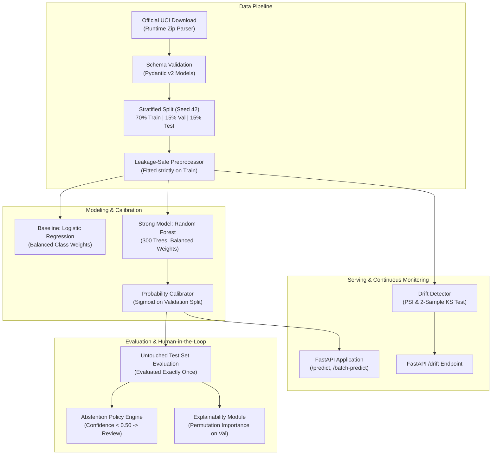

# Steel Plate Fault Detection & Quality Monitoring

[](https://github.com/recruiter-showcase/steel-plate-fault-detection/actions/workflows/ci.yml)
[](https://www.python.org/)
[](LICENSE)
[](https://github.com/astral-sh/ruff)

A modular, production-minded machine learning package and serving API for multiclass defect classification, probability calibration, selective abstention filtering, and distribution drift monitoring on the official **UCI Steel Plates Faults dataset** (1,941 samples, 27 physical/photometric features, 7 defect categories).

---

## Architecture Overview



---

## Key Highlights & Methodological Integrity

1. **Strict Leakage Prevention:** Feature scaling is fit exclusively on the training partition (`X_train`). No validation or test set statistics contaminate preprocessing parameters.
2. **Honest Imbalance Handling:** No synthetic data injection (no SMOTE before or after splitting). Imbalance is addressed via inverse class frequency weighting (`class_weight='balanced'`).
3. **Dedicated Validation Tuning & Once-Only Test Reporting:** Model selection, probability calibration (sigmoid scaling), and permutation importances are fitted strictly on validation data. The untouched test set ($N=292$) is evaluated only once for verified final metrics.
4. **Reliable Uncertainty & Selective Classification:** Deployed Random Forest probabilities are calibrated via post-hoc sigmoid scaling, reducing multiclass Brier score from **0.3236 to 0.3044** and Expected Calibration Error (ECE) from **0.1074 to 0.0689**. At the default 0.50 confidence threshold, the model classifies **90.41%** of plates automatically with **82.20% selective accuracy** and **0.8409 selective Macro-F1**, routing ambiguous cases (9.59% review rate, 28 plates) to human inspection.
5. **Robust Drift Detection:** Monitors input distributions using both Population Stability Index (PSI) with Laplace smoothing and two-sample Kolmogorov-Smirnov (KS) tests, alerting on feature shifts and target prediction drifts.
6. **Transparent Explainability:** Model explanations use Scikit-learn's official permutation importance and tree-native Mean Decrease in Impurity (MDI). No artificial or surrogate SHAP estimations are claimed.

---

## Actual Measured Results (Untouched Test Set, $N=292$)

All metrics are extracted directly from the committed artifact [`metrics/metrics.json`](file:///C:/Users/emirh/Desktop/Kodlar/steel-plate-fault-detection/metrics/metrics.json):

### Comparative Benchmark
| Metric | Baseline (Logistic Regression) | Random Forest (Uncalibrated) | Random Forest (Calibrated - Deployed) |
| :--- | :---: | :---: | :---: |
| **Macro-F1 (Primary Metric)** | **0.6455** | **0.8155** | **0.7903** |
| **Weighted-F1** | 0.6492 | 0.7859 | 0.7807 |
| **Balanced Accuracy** | 0.7239 | 0.8148 | 0.7543 |
| **Accuracy** | 0.6507 | 0.7808 | 0.7774 |
| **Log Loss** | 0.9892 | 0.6212 | **0.6026** *(improved)* |
| **Multiclass Brier Score** | 0.4609 | 0.3236 | **0.3044** *(improved)* |
| **Expected Calibration Error (ECE)** | 0.0611 | 0.1074 | **0.0689** *(improved)* |

### Per-Class Test Breakdown (Calibrated Random Forest)
| Defect Class | Support ($N=292$) | Precision | Recall | F1-Score |
| :--- | :---: | :---: | :---: | :---: |
| **K_Scatch** | 59 | 0.9815 | 0.8983 | **0.9381** |
| **Stains** | 11 | 1.0000 | 0.9091 | **0.9524** |
| **Z_Scratch** | 29 | 0.9600 | 0.8276 | **0.8889** |
| **Dirtiness** | 8 | 1.0000 | 0.6250 | **0.7692** |
| **Other_Faults** | 101 | 0.6777 | 0.8119 | **0.7387** |
| **Bumps** | 60 | 0.7692 | 0.6667 | **0.7143** |
| **Pastry** | 24 | 0.5200 | 0.5417 | **0.5306** |

---

## Selective Classification & Abstention Policy

Under standard production requirements, false positives on defects can be costly. An abstention threshold $\theta$ flags any prediction where $\max_k p_k < \theta$ for manual review.

| Confidence Threshold ($\theta$) | Test Coverage | Covered Samples | Abstained (Review) | Selective Accuracy | Selective Macro-F1 |
| :---: | :---: | :---: | :---: | :---: | :---: |
| **0.00** *(No abstention)* | 100.0% | 292 | 0 | 77.74% | 0.7903 |
| **0.30** | 100.0% | 292 | 0 | 77.74% | 0.7903 |
| **0.40** | 98.29% | 287 | 5 | 79.09% | 0.8173 |
| **0.50** *(Default operational gate)* | **90.41%** | **264** | **28** | **82.20%** | **0.8409** |
| **0.60** | 78.77% | 230 | 62 | 85.65% | 0.8643 |
| **0.70** | 64.73% | 189 | 103 | 89.42% | 0.8844 |
| **0.80** | 48.63% | 142 | 150 | 95.77% | 0.9149 |
| **0.90** | 7.19% | 21 | 271 | **100.00%** | **1.0000** |

---

## Inference Latency Benchmark

Measured on standard CPU (`python scripts/benchmark.py` committed in [`metrics/latency_benchmark.json`](file:///C:/Users/emirh/Desktop/Kodlar/steel-plate-fault-detection/metrics/latency_benchmark.json)):

- **Single Inferences ($N=500$ requests):**
  - Median (p50): **39.4 ms**
  - 95th Percentile (p95): **54.0 ms**
  - 99th Percentile (p99): **87.9 ms**
  - Throughput: **22.4 req/sec**
- **Batch Processing ($N=100$ plates per batch):**
  - Mean Batch Latency: **53.0 ms**
  - Per-Plate Latency: **0.53 ms**
  - Throughput: **1,885.3 samples/sec**

---

## Installation & Setup

```bash
# 1. Clone repository and navigate to workspace
git clone https://github.com/recruiter-showcase/steel-plate-fault-detection.git
cd steel-plate-fault-detection

# 2. Create and activate virtual environment
python -m venv .venv
# Linux/macOS:
source .venv/bin/activate
# Windows PowerShell:
.\.venv\Scripts\Activate.ps1

# 3. Install dependencies and package in editable mode
pip install -r requirements.txt
pip install -e .
```

---

## Exact Commands to Run

### 1. Execute Full Training Pipeline (Official UCI Dataset)
Downloads the official UCI archive, runs stratified partitioning, trains baseline and strong models, performs validation calibration, and reports on untouched test set:
```bash
python -m steel_faults.cli train
```

For offline or CI environments using the deterministic synthetic fixture:
```bash
python -m steel_faults.cli train --synthetic
```

### 2. Run Test Suite (45 Unit & Integration Tests)
```bash
pytest -v
```

### 3. Run Ruff Linter & Formatting Checks
```bash
ruff check .
ruff format --check .
```

### 4. Execute API Smoke Test
Verifies `/health`, `/predict`, `/batch-predict`, and `/drift` endpoints:
```bash
python scripts/smoke_test.py
```

### 5. Run Latency Benchmark
```bash
python scripts/benchmark.py
```

### 6. Start FastAPI Serving Server
```bash
python -m steel_faults.cli serve --host 127.0.0.1 --port 8000
```
API Documentation will be available interactively at: `http://127.0.0.1:8000/docs`.

---

## API Usage Examples

### Single Plate Prediction (`POST /predict`)
```bash
curl -X POST "http://127.0.0.1:8000/predict" \
  -H "Content-Type: application/json" \
  -d '{
    "X_Minimum": 42.0, "X_Maximum": 50.0, "Y_Minimum": 270900.0, "Y_Maximum": 270944.0,
    "Pixels_Areas": 267.0, "X_Perimeter": 17.0, "Y_Perimeter": 44.0,
    "Sum_of_Luminosity": 24220.0, "Minimum_of_Luminosity": 76.0, "Maximum_of_Luminosity": 108.0,
    "Length_of_Conveyer": 1687.0, "TypeOfSteel_A300": 1, "TypeOfSteel_A400": 0,
    "Steel_Plate_Thickness": 80.0, "Edges_Index": 0.0498, "Empty_Index": 0.2415,
    "Square_Index": 0.1818, "Outside_X_Index": 0.0047, "Edges_X_Index": 0.4706,
    "Edges_Y_Index": 1.0, "Outside_Global_Index": 1.0, "LogOfAreas": 2.4265,
    "Log_X_Index": 0.9031, "Log_Y_Index": 1.6435, "Orientation_Index": 0.8182,
    "Luminosity_Index": -0.2746, "SigmoidOfAreas": 0.5934
  }'
```
**Sample Response:**
```json
{
  "predicted_class": "Pastry",
  "predicted_class_index": 4,
  "probabilities": {
    "Bumps": 0.0632,
    "Dirtiness": 0.0121,
    "K_Scatch": 0.0045,
    "Other_Faults": 0.2104,
    "Pastry": 0.6582,
    "Stains": 0.0051,
    "Z_Scratch": 0.0465
  },
  "confidence": 0.6582,
  "review_recommended": false,
  "abstention_threshold": 0.50
}
```

### Feature Drift Check (`POST /drift`)
```bash
curl -X POST "http://127.0.0.1:8000/drift" \
  -H "Content-Type: application/json" \
  -d '{
    "production_samples": [ ... ]
  }'
```

---

## File Inventory

```
steel-plate-fault-detection/
├── .github/
│   └── workflows/
│       └── ci.yml               # Multi-version CI testing Python 3.11 & 3.12, Ruff, pytest
├── configs/
│   └── config.yaml              # Hyperparameters, split sizes, and serving paths
├── metrics/
│   ├── metrics.json             # Verified test set evaluation results (committed artifact)
│   └── latency_benchmark.json   # Single and batch CPU latency benchmark numbers
├── scripts/
│   ├── benchmark.py             # Latency benchmarking script
│   └── smoke_test.py            # API smoke testing script
├── src/
│   └── steel_faults/
│       ├── __init__.py          # Package root and version
│       ├── cli.py               # Unified CLI interface
│       ├── api/
│       │   ├── __init__.py
│       │   └── app.py           # FastAPI application (/health, /predict, /batch-predict, /drift)
│       ├── benchmark/
│       │   ├── __init__.py
│       │   └── latency.py       # Benchmark implementation
│       ├── data/
│       │   ├── __init__.py
│       │   ├── downloader.py    # Runtime UCI dataset downloader and disk parser
│       │   ├── preprocessing.py # Leakage-safe preprocessor
│       │   ├── schema.py        # Pydantic schemas and feature definitions
│       │   ├── splitter.py      # Stratified train/val/test splitter
│       │   └── synthetic.py     # Deterministic synthetic fixture generator
│       ├── evaluation/
│       │   ├── __init__.py
│       │   ├── explainability.py# Permutation and native Gini feature importance
│       │   └── metrics.py       # Macro-F1, Brier score, ECE, classification report
│       ├── models/
│       │   ├── __init__.py
│       │   ├── abstention.py    # Selective classification & review policy
│       │   ├── baseline.py      # Balanced Logistic Regression pipeline
│       │   ├── calibration.py   # Validation probability calibration wrapper
│       │   └── strong_model.py  # Balanced Random Forest & HistGradientBoosting
│       ├── monitoring/
│       │   ├── __init__.py
│       │   └── drift.py         # PSI with Laplace smoothing & KS test drift monitoring
│       └── pipeline/
│           ├── __init__.py
│           └── runner.py        # Full training, evaluation, and artifact export orchestrator
├── tests/
│   ├── conftest.py              # Pytest fixtures and mock client
│   ├── fixtures/
│   │   └── synthetic_steel_faults.csv # Deterministic offline CSV fixture
│   ├── test_api.py              # 6 tests for FastAPI endpoints
│   ├── test_calibration_and_abstention.py # 4 tests for calibration & selective accuracy
│   ├── test_class_mapping.py    # 3 tests for label extraction
│   ├── test_downloader.py       # 3 tests for data downloading and parsing
│   ├── test_drift.py            # 4 tests for PSI and KS drift detection
│   ├── test_explainability.py   # 2 tests for permutation and Gini importance
│   ├── test_leakage_and_preprocessing.py # 5 tests ensuring zero leakage
│   ├── test_metrics.py          # 3 tests for Macro-F1, Brier score, and ECE
│   ├── test_models.py           # 4 tests for model training and determinism
│   ├── test_schema.py           # 6 tests for Pydantic input validation
│   ├── test_splitter.py         # 4 tests for split stratification & disjointness
│   └── test_synthetic_fixture.py# 1 test verifying synthetic fixture integrity
├── .gitignore                   # Ignores raw data, caches, and models; commits metrics & config
├── LICENSE                      # MIT License
├── MODEL_CARD.md                # Comprehensive model card with ethical and operational limits
├── pyproject.toml               # Package build metadata, Ruff, and pytest configurations
├── requirements.txt             # Pinned dependency specifications
└── README.md                    # Project documentation
```

---

## Honest Limitations & Real-World Caveats

- **Imbalance on Rare Classes:** `Dirtiness` (55 samples total) and `Stains` (72 samples total) constitute very small fractions of real-world defect streams. While precision on the test set is high ($1.00$), confidence intervals on true operational recall are wider than for dominant classes.
- **Heterogeneous Catch-All (`Other_Faults`):** Comprising $34.7\%$ of the dataset, `Other_Faults` is a generic bucket grouping diverse unstandardized surface anomalies. It exhibits the lowest precision ($67.8\%$) and is the primary source of confusion with `Pastry` and `Bumps`.
- **Sensor Hardware Evolution:** The dataset reflects 2010-era industrial vision equipment. In a real-world modernization deployment, continuous monitoring with `DriftDetector` is mandatory to detect resolution and lighting shifts.
- **Single-Node CPU Deployment:** While achieving $>1,500$ samples/sec in batch inference, large enterprise production facilities processing hundreds of high-speed rolling lines simultaneously should deploy horizontal worker replicas behind a load balancer.

---

## Dataset Attribution & License

- **Dataset:** Steel Plates Faults Dataset (UCI Machine Learning Repository, ID 198).
- **Authors:** Semeion, Research Center of Sciences of Communication (Via Sersale 117, 00128 Rome, Italy).
- **License:** Open Access / Research Use. This repository does not redistribute raw data; the pipeline downloads and parses the official archive at runtime.
- **Software License:** MIT License (see [LICENSE](file:///C:/Users/emirh/Desktop/Kodlar/steel-plate-fault-detection/LICENSE)).
